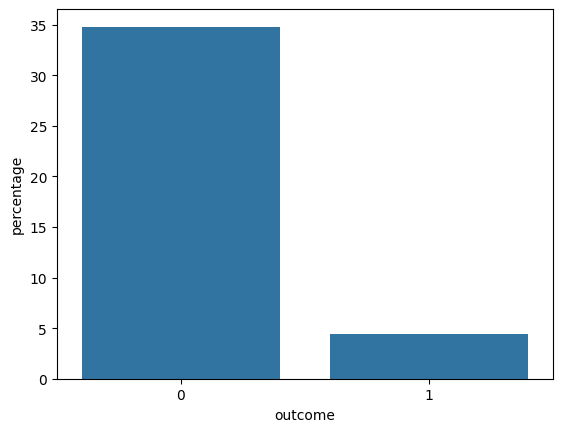
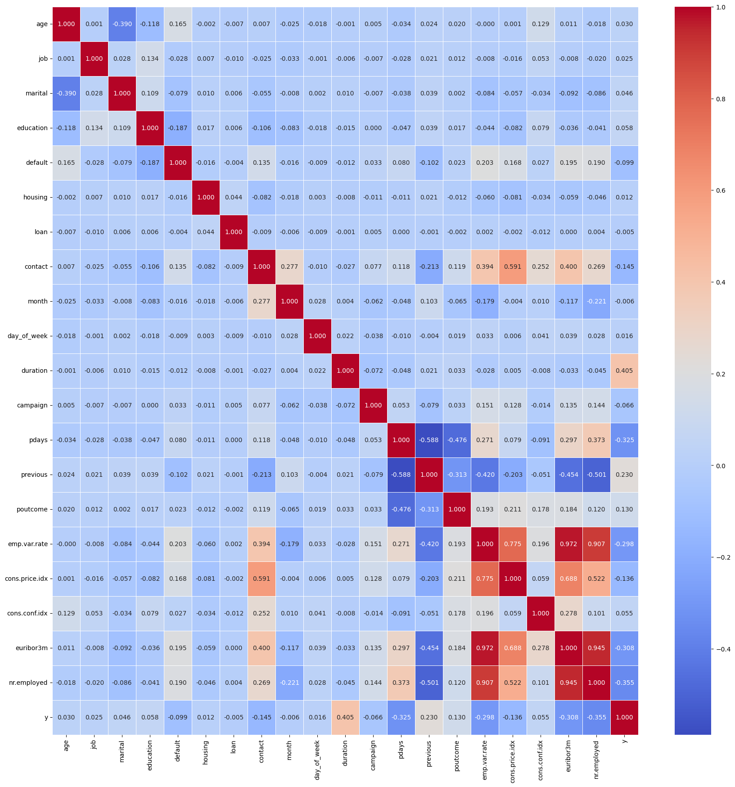
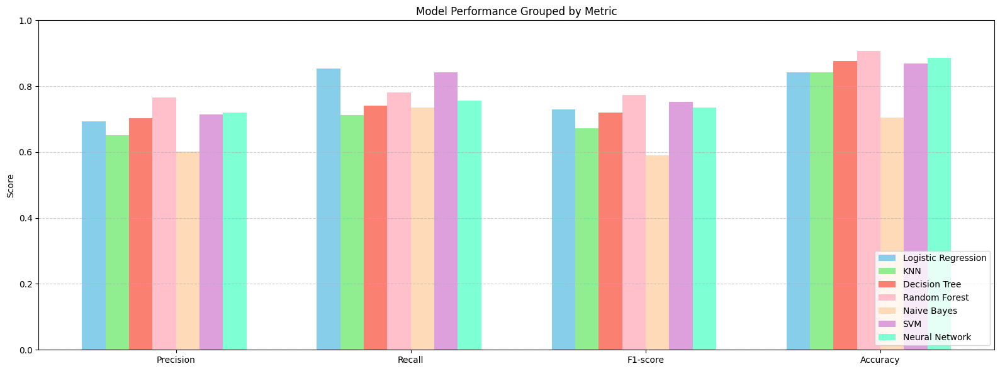
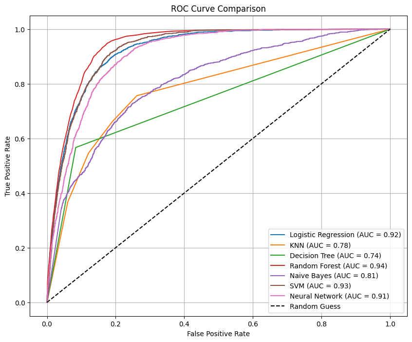
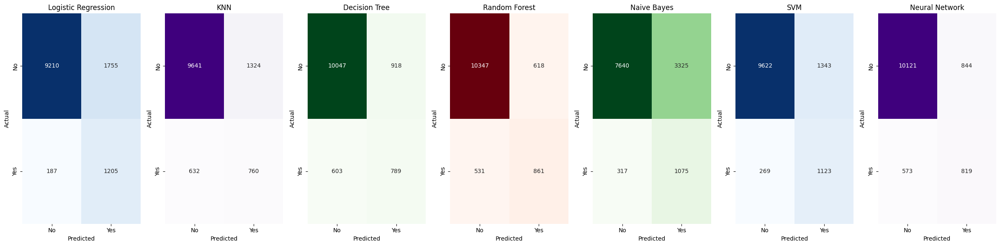
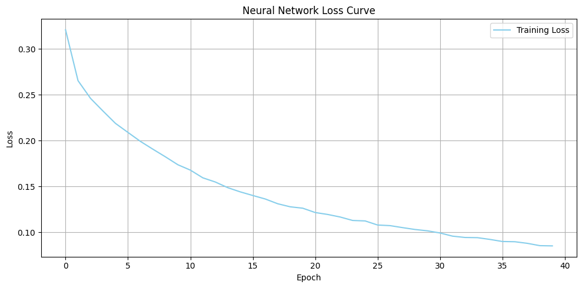

# Predictive Modeling for Bank Marketing Campaigns

**CSE422 (Artificial Intelligence) Project, BRAC University, Spring 2025**

This project predicts whether a bank client will subscribe to a term deposit, using the
[Bank Marketing dataset](Bank_Marketing.csv). Seven classifiers are trained and compared,
so a bank can aim its campaigns at the clients most likely to say yes and spend less on
the rest.

## Authors

| Student ID | Name |
|---|---|
| 22201055 | **Maliha Rahman** |
| 22201108 | Mohammad Jabir Safa Khandoker |

> **Credit:** Maliha Rahman did most of the work on this project. Thank you, Maliha!

Department of Computer Science and Engineering, BRAC University, Dhaka, Bangladesh (May 2025).

## Repository Contents

| File | Description |
|---|---|
| [Group03.ipynb](Group03.ipynb) | Main notebook: EDA, preprocessing, model training and evaluation |
| [Group03.pdf](Group03.pdf) | PDF export of the notebook |
| [Bank_Marketing.csv](Bank_Marketing.csv) | Dataset |
| [CSE422_Project_Cover-combined.pdf](CSE422_Project_Cover-combined.pdf) | Full project report with cover page |
| [CSE422_Project_Report.docx](CSE422_Project_Report.docx) | Editable report |
| `*.png` | Figures used in the report |

## Dataset

- **41,188** instances, **20** features (10 categorical, 10 numerical)
- Binary target `y`: did the client subscribe ("yes"/"no")?

| Categorical | Numerical |
|---|---|
| job, marital, education, default, housing, loan, contact, month, day_of_week, poutcome | age, duration, campaign, pdays, previous, emp.var.rate, cons.price.idx, cons.conf.idx, euribor3m, nr.employed |

**Class imbalance:** the target is heavily skewed. 36,548 clients (88.73%) said "no" and
4,640 (11.27%) said "yes".



## Exploratory Data Analysis

Histograms and box plots show the distributions and outliers of the numeric features. The
correlation heatmap shows several strongly correlated (and so partly redundant) features:

| Feature 1 | Feature 2 | Correlation |
|---|---|---|
| emp.var.rate | euribor3m | 0.972 |
| emp.var.rate | nr.employed | 0.907 |
| euribor3m | nr.employed | 0.945 |



## Preprocessing

1. **Sentinel handling (`pdays`):** the value 999 means "never contacted". `pdays` was
   replaced by a binary `pdays_contacted` flag and a log-transformed `pdays_notcontacted`
   column (999 treated as missing). The original column was dropped.
2. **Null values:** the only nulls came from the step above. They were filled with the median.
3. **Encoding:** the target `y` was label-encoded to 0/1. The other categorical features were
   one-hot encoded with `drop_first=True` to avoid multicollinearity.
4. **Skewness:** numeric columns with skewness above 1 and no negative values got a `log1p`
   transform.
5. **Scaling:** numeric features were standardized with `StandardScaler`.
6. **Splitting and balancing:** a stratified 70/30 train/test split, SMOTE oversampling on the
   training data, and `class_weight='balanced'` where the model supports it.

## Models

| Algorithm | Configuration |
|---|---|
| Logistic Regression | `max_iter=5000, class_weight='balanced'` |
| K-Nearest Neighbors | `n_neighbors=4` |
| Decision Tree | `class_weight='balanced'` |
| Random Forest | `class_weight='balanced', random_state=42` |
| Naive Bayes | `GaussianNB` (defaults) |
| Support Vector Machine | `probability=True, class_weight='balanced'` |
| Feed-Forward Neural Network | Dense 64 → 32 (ReLU) → 1 (sigmoid); Adam (lr=0.001); binary cross-entropy; 40 epochs; batch size 20 |

Linear regression was not used because this is a classification problem.

## Results

Scores for the positive class ("yes"):

| Model | Precision | Recall | F1 | Accuracy | AUC |
|---|---|---|---|---|---|
| Logistic Regression | 0.41 | **0.87** | 0.55 | 0.84 | 0.92 |
| KNN | 0.36 | 0.55 | 0.44 | 0.84 | 0.78 |
| Decision Tree | 0.46 | 0.57 | 0.51 | 0.88 | 0.74 |
| Random Forest | **0.58** | 0.62 | **0.60** | **0.91** | **0.94** |
| Naive Bayes | 0.24 | 0.77 | 0.37 | 0.71 | 0.81 |
| SVM | 0.46 | 0.81 | 0.58 | 0.87 | 0.93 |
| Neural Network | 0.49 | 0.59 | 0.54 | 0.87 | 0.91 |

<p>
  
  
</p>




## Conclusion

- **Random Forest** had the best overall results: the highest accuracy (0.91), precision (0.58),
  F1 (0.60) and AUC (0.94).
- **Logistic Regression** had the highest recall (0.87), so it misses the fewest likely
  subscribers. It is the better choice when catching positives matters most.
- **SVM** balanced precision and recall well. The **Neural Network** did well but scored
  slightly below the ensemble method.
- **KNN** struggled with the class imbalance, and **Naive Bayes** did poorly because the
  features are not independent of each other.

**Which model to use depends on the priority:** Logistic Regression to maximize recall, or
Random Forest for the best precision/recall balance (F1).

### Challenges

- The heavy class imbalance, which can bias models toward the majority class
- Choosing which features to keep, to avoid overfitting and redundancy
- The `pdays` sentinel value (999), which skews results if not handled separately

## How to Run

1. Install the dependencies:
   ```bash
   pip install pandas numpy matplotlib seaborn scikit-learn imbalanced-learn tensorflow scikeras
   ```
2. Open [Group03.ipynb](Group03.ipynb) in Jupyter or Google Colab.
3. The notebook reads the dataset from a Google Drive path
   (`/content/drive/MyDrive/CSE422_Project/Bank_Marketing.csv`). Change this path to point to
   your copy of `Bank_Marketing.csv`.
4. Run all cells.
